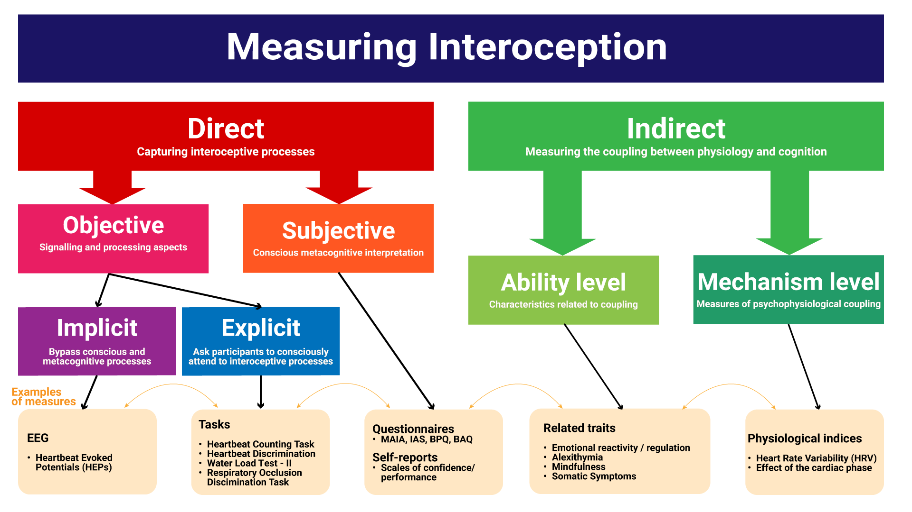
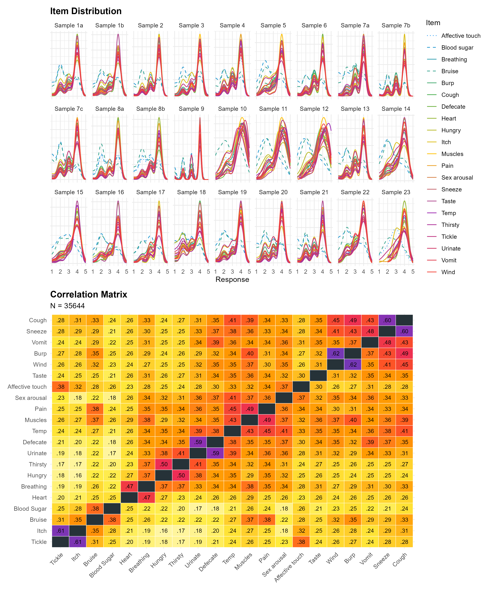
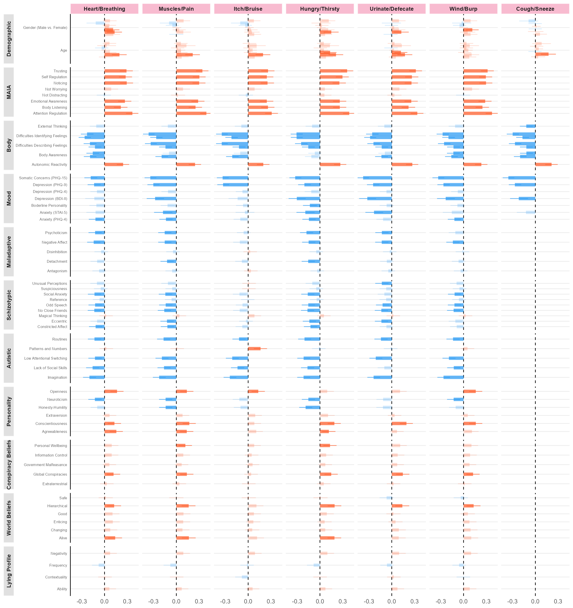
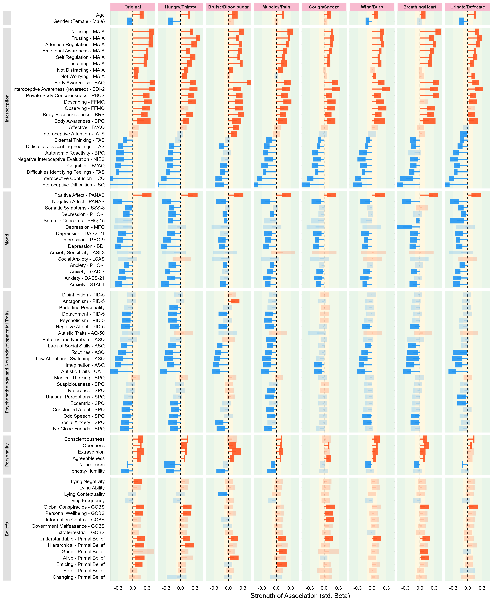

# Introduction

<!-- Interoception definition -->

Interoception refers to **the top-down and bottom-up processes by which organisms sense, interpret and integrate information of internal signals, across conscious and unconscious levels [@desmedt2025discrepancies; @khalsa2018interoception].** Despite its recognised role in emotion recognition [@terasawa2021effects] and regulation [@zamariola2019relationship], decision making [@pollatos2023interoceptive], learning [@joshi2023interoception], body-ownership [@raimo2021body], physical health [@harrison2024interoception] and psychological health [@nord2021disrupted], and well-being [@ferentzi2019body], the field remains hampered by concerns over its conceptualisation and measurement [@desmedt2025discrepancies; @desmedt2022measures; @murphy2024interoception]. 

## The Interoceptive Assessment Puzzle

<!-- Interoception measure -->

Given interoception's centrality to brain function, many measures could be seen as "indirectly" assessing (whether intentionally or not) interoceptive processes, including indices quantifying coupling between physiological signals and cognitive or behavioural processes (e.g., Heart Rate Variability**, or the coupling of cardiac, respiratory and gastric rhythms with large-scale brain dynamics, @tallonbaudry2026dual**), or constructs theoretically dependent on interoceptive information (e.g., alexithymia), **which are related to, but not part of, interoception itself [@desmedt2025discrepancies]**.
Critically, various *direct* measures have also been developed (see @fig-measures**, an illustrative overview of measurement approaches**), spanning "objective" and "subjective" assessments (e.g., heartbeat counting/tracking tasks *vs.* questionnaires and scales), "explicit" and "implicit" paradigms (i.e., directing *vs.* covertly measuring attention to interoceptive processes), multiple modalities (e.g., cardioception, respiroception, gastroception), and theoretical dimensions (e.g., accuracy, sensitivity, awareness).
<!-- While there is no consensus as to which particular approach provides the most accurate and "pure" measure of interoception and interoceptive abilities (assuming it is a unidimensional construct), it is instead plausible that each measure has strengths and limitations, and a utility dependent on the context and goal at hand [@jahedi2014; @Desmedt2023accuracy]. -->
The diversity of measures reflects the absence of a "gold-standard" for interoception, with each having strengths and limitations depending on the research context and dimension assessed [@jahedi2014; @Desmedt2023accuracy].

```{r}
#| warning: false
#| label: "fig-measures"
#| apa-twocolumn: true  # A Figure Spanning Two Columns When in Journal Mode
#| out-width: "100%"
#| fig-cap: "**Overview of Methods Used in Interoception Research and Adjacent Fields. This is an illustrative breakdown of the measures used to target interoception and interoception-related processes, not a taxonomy or model of interoception: it makes no claim about how interoception is structured or what its levels are. Measures can target different modalities (e.g., cardioception) and assess them directly or indirectly.** Direct assessments can be subjective or objective, depending on whether they use conscious metacognitive appraisals or performance-based indices. Objective interoceptive tasks can be explicit (participants must consciously attend to interoceptive signals; e.g., the heartbeat counting task) or implicit (measurements of interoception are covert; e.g., heartbeat evoked potentials measured during rest). Indirect assessments **quantify the coupling between bodily signals and brain or cognitive processes (mechanism level; e.g., heart rate variability or effects of the cardiac phase), or assess traits related to, or thought to depend on, interoceptive processes (ability level; e.g., self-report measures of emotion regulation or alexithymia). The latter are interoception-adjacent constructs rather than measures of interoception itself.**"


```

## Self-reported Interoception

<!-- self-reports -->
Although using self-report questionnaires to measure deeply embodied functions might seem paradoxical, recent redefinitions of interoception emphasize the importance of metacognitive elaboration of interoceptive information, supporting the idea that some facets such as metacognitive beliefs, can be assessed subjectively [@khalsa2018interoception; @suksasilp2022towards].
The notion that self-reported interoception reflects a fundamentally different aspect of conscious interoceptive processing than objective task measures is thought to be central to understanding the reported lack of convergence between objective and subjective measures [@desmedt2022measures]. 
**Questionnaires and tasks such as the Heartbeat Counting Task [HCT, @schandry1981heart] and the Heartbeat Detection Task [HDT, @kleckner2015methodological] correlate weakly or not at all, even when intended to capture the same dimension [e.g., task-based vs. self-reported accuracy; @murphy2019; @brand2023; @arslanova2022]. Two non-exclusive explanations may account for this [@desmedt2025discrepancies]: measures labelled as assessing the same dimension may capture different constructs, or correlations may be attenuated by measurement error, such as guessing strategies in heartbeat counting [@desmedt2025discrepancies] or the low internal consistency of some questionnaire subscales [e.g., MAIA Noticing, TAS-20 Externally Oriented Thinking; @gaggero2021]. Weak correlations alone are therefore not evidence of distinct constructs.**

Perhaps more surprisingly, lack of convergence also exists amongst objective or subjective measures purporting to measure the same interoceptive dimension: **performance-based tasks such as the HCT and HDT, both used to index cardiac interoceptive accuracy, rely on different processes and show weak or no intercorrelations** [@brand2023; @hickman2020relationship; @Desmedt2023accuracy; @legrand2022heart], and subjective accuracy scores similarly yield weaker than expected relationships [@vig2022questionnaires]. As well as posing substantial validity concerns, these findings raise the possibility that even within a broad measurement domain, different measures are targeting fundamentally different facets of interoception, undermining replicability and hindering theoretical and empirical progress in the field.

One striking example concerns the assessment of interoceptive sensibility [**interoceptive attention bias in the framework of @desmedt2025discrepancies**] - the self-reported tendency to focus on (with or without correctly detecting) internal sensations [@garfinkel2015knowing; @khalsa2018interoception].
A recent systematic review suggested that questionnaires designed to assess interoceptive sensibility may in fact measure distinct constructs, with researchers often treating them as equivalent despite low overall convergence [@desmedt2022measures]. **Constructs and instruments are thus often conflated, even among questionnaires: a questionnaire is taken to measure the construct it is labelled with, regardless of what it actually captures [@desmedt2025discrepancies]. Throughout this paper, we therefore keep the two distinct.**
The review included popular measures, such as the Body Perception Questionnaire [BPQ, @porges1993body], the Multidimensional Assessment of Interoceptive Awareness [MAIA, @mehling2012; MAIA-2, @mehling2018multidimensional], the Body Awareness Questionnaire [BAQ, @shields1989body], the Private subscale of the Body Consciousness Questionnaire [PBCS, @miller1981consciousness], and the Self-Awareness Questionnaire [SAQ, @longarzo2015self] which comprised 86% of all citations. Their low-to-moderate intercorrelations suggest they capture different aspects of interoception rather than a common construct, emphasizing the need for conceptual clarity regarding what each measures, how they relate to different interoception dimensions, and their overlap with constructs such as alexithymia and body awareness. One avenue for addressing these issues is the investigation of newer measures not included in prior reviews.

## The Interoceptive Accuracy Scale (IAS)

<!-- Introducing the IAS -->

Focusing on self-perceived *accuracy*, the Interoceptive Accuracy Scale [IAS, @murphy2019] is a recently developed measure with rapidly growing popularity. The IAS was designed to clarify both what and how interoception is measured, by treating interoceptive accuracy and attention as distinct dimensions, whereas many existing models conflate them [e.g., @garfinkel2015knowing; @khalsa2018interoception]. Individuals may thus report attending to bodily signals while recognising their perception of those signals is inaccurate. This distinction positions the IAS as the only tool specifically designed to assess **self-perceived interoceptive accuracy** **(i.e., individuals’ beliefs about how accurately they detect internal sensations)**, marking a conceptual advance in interoceptive measurement.
**In the hierarchical framework of @desmedt2025discrepancies, the IAS is thus a self-report measure of interoceptive detection (under the broad factor of interoceptive sensing) across multiple bodily domains, rather than a definition of interoceptive accuracy itself.**
**With each item targeting a different bodily domain, the IAS also allows testing whether self-perceived accuracy is a single general ability or a set of domain-specific appraisals, a question its inconsistent factor structure has left unresolved.**

The IAS comprises 21 Likert-scale items assessing perceived accuracy across physiological modalities, one item per modality such as respiration (*"I can always accurately perceive when I am breathing fast"*), heart (*"I can always accurately perceive when my heart is beating fast"*), skin (*"I can always accurately perceive when something is going to be ticklish"*), arousal or bodily functions like coughing (*"I can always accurately perceive when I am going to cough"*) or urinating (*"I can always accurately perceive when I need to urinate"*). Its items capture specific interoceptive behaviors and "objective" experiences (albeit subjectively reported), a notable distinction from other popular questionnaires, such as the MAIA-2, which includes broader metacognitive items (e.g., *"I trust my body sensations"*, *"I can notice an unpleasant body sensation without worrying about it"*), and dimensions related to attention and emotion regulation (e.g., Not-distracting and Not-worrying subscales respectively).

<!-- IAS structure  -->
The original IAS validation study suggested a two-factor structure: one reflecting the perception of interoceptive signals (urinate, hungry, defecate, thirsty, pain, heart, taste, breathing, temperature, muscles, affective touch, vomit, sexual arousal), and another comprising signals difficult to perceive through interoception alone or reflecting socially unacceptable functions (itch, tickle, cough, burp, bruise, blood sugar, sneeze, wind). The authors highlight the imperfect fit of this solution [@murphy2019, p. 127], with subsequent studies identifying different optimal structures. Specifically, @brand2023 reported a 1-factor solution as best fit, whereas @lin2023 and @campos2021 found bifactor solutions [i.e., one general factor above lower-level factors, @rodriguez2016evaluating]. Using Exploratory Factor Analysis (EFA), and constraining the solution to two factors, @koike2023 identified a different 2-factor structure distinguishing cutaneous (e.g., itching, tickling, affective touch, muscle sensations) from visceral sensations (e.g., hunger, thirst, heartbeat, breathing).

Beyond factor structure, discussion has also concerned the specificity of individual IAS items. For instance, @murphy2019 note that while some items measure direct interoceptive signals (e.g., cardioception), others capture phenomena detectable through non-interoceptive means (e.g., "bruising" via skin discoloration; p. 119). @lin2023 identify several psychometric limitations, including five locally dependent item pairs and three items (touch, blood sugar, bruise) with high difficulty and low discrimination, suggesting further refinement is needed. Localisation issues also arose, with "itch" and "tickle" mapping to the same Chinese character and thus collapsed into a single item [@lin2023]. @campos2021 further suggested the IAS is predominantly unidimensional, with all items except "tickle" reflecting a general factor.

<!-- Relationship with other interoception measures -->

**Regarding convergent validity, the IAS correlates positively with most MAIA facets [@mehling2018multidimensional; @gaggero2021], except Not-Distracting and Not-Worrying [@brand2023], two subscales only weakly related to the general factor underlying the other MAIA subscales [@ferentzi2021examining].**
Comparisons with the BPQ body awareness dimension have been mixed, with studies reporting small positive [@brand2023; @koike2023; @gaggero2021], small negative [@lin2023], quadratic positive [@campos2021], or no correlations [@murphy2019]. Positive correlations have been observed for four of five FFMQ subscales [@baer2006using; @brand2023; @koike2023], the EDI interoceptive awareness subscale [EDI-IA, @lin2023], and negative correlations with the Interoceptive Confusion Questionnaire [ICQ, @brewer2016alexithymia; @brand2023; @murphy2019]. Finally, the IAS' typically small correlation with the Interoceptive Attention Scale [IATS, @gabriele2022dissociations; @lin2023; @koike2023] supports the distinction between interoceptive accuracy and attention.

<!-- Convergent validity (correlates)  -->
**Beyond interoception measures, the IAS shows** consistent negative associations with alexithymia [@brand2023; @koike2023; @campos2021; @murphy2019; @lin2023], somatic [@brand2023; @koike2023; @lin2023] and depressive symptoms [@brand2023; @koike2023; @lin2023], anxiety [@brand2023], neuroticism [@brand2023], and self-esteem [@murphy2019]**, although associations with alexithymia vary across interoceptive dimensions and alexithymia facets [@trevisan2019meta; @vanbael2024systematic]**.
**Together, these findings outline a nomological network for self-perceived interoceptive accuracy: positive associations with most multidimensional interoception questionnaires, negative associations with interoceptive confusion (ICQ), alexithymia, and depressive, anxious and somatic symptoms, and only weak associations with a dedicated measure of interoceptive attention (IATS) and with objective task performance [@murphy2019; @brand2023].**
**The IAS'** overlap with other interoception-related questionnaires across theoretical dimensions further highlights limitations of strictly orthogonal interoceptive models. While the IAS shows promise, further refinement is needed; something the present paper seeks to address with two aims.


<!-- current study -->
Given increasing interest in interoception across psychology and neuroscience, and the growing use of the IAS, careful scrutiny of this novel measure of **self-perceived** interoceptive accuracy is warranted. Therefore, the current study has two aims. First (Study 1), to clarify the structure of the IAS using a mega-analytic approach which leverages existing data by aggregating datasets and re-analysing them at the raw data level. This aggregated data will then be used to contrast traditional CFA/SEM and Hierarchical Clustering Analysis (HCA) with newer network-based approaches (Exploratory Graph Analysis, EGA). By triangulating results across different samples and conceptually distinct analytical frameworks, the current paper aims to provide a more nuanced and method-independent view of IAS structure, identifying both convergent and potentially overlooked structural features that may not be apparent when relying on a single analytic approach. The second aim (Study 2) is to provide an overview of construct validity and the dispositional correlates of the IAS, clarifying its general pattern of associations with interoception-related constructs, mood, psychopathological and neurodevelopmental traits, and other relevant measures, thereby situating interoceptive questionnaires within a broader context.


# Study 1

Study 1 re-analyses the factor structure of the IAS using raw data across **23 datasets** [@brand2023; @campos2021; @lin2023; @murphy2019; @arslanova2022; @todd2022; @gaggero2021; @brand2022; @von2023; @poerio2024interoceptive; @petzke2024somatic; **@adams2026associations; @moffatt2026validity; @reid2025interoceptive; @kvamme2026interoceptive; @folz2024individual; @koike2026improved**]. Combining studies yields a more robust and generalizable understanding of the IAS' factor structure. However, as studies differ in sample size, demographic characteristics, language, and procedure, we also analyse each sample individually to add nuance to the general picture.

## Methods

### Datasets

We searched papers citing the original IAS validation paper [@murphy2019], identifying 136 (as of **3 of October 2026**). Inclusion required open-access raw data with individual IAS item scores; datasets shared directly by authors were also included. Consequently, **23** datasets were used, including five from unpublished studies (see @tbl-table1), totaling **35,644** participants (Mean = 47.96 $\pm$ 13.1, 71.3\% Female). **Overall, of the 23,701 people with ethnicity data (10 samples), 92.2% are White, 2.9% Asian, 2.1% Mixed, 1.5% Black, 0.6% Other, 0.5% Hispanic/Latino and 0.3% Middle Eastern/North African.**
**The study was not pre-registered.**

<!-- Note: this table is generated during data analysis -->

::: landscape 

```{r}
#| label: tbl-table1
#| tbl-cap: "Description of the samples used in Study 1 mega-analysis."
#| apa-note: "*Information taken from the sample description of relevant paper rather than recomputed. Samples 11–13 (Makowski et al., 2023a, b, c) used analogue scales and were rescaled from a 0–1 range to a 1–5 scale to ensure comparability with the other samples. †In the Japanese IAS used in Sample 23, the Blood sugar item was replaced by \"tired\" [@koike2023]; this item was therefore not used."
##| apa-twocolumn: true
#| error: false
#| warning: false

library(flextable)
set_flextable_defaults(font.size = 11)

table <- readRDS("../../analysis/figures/table1.rds")

table |>
    dplyr::rename("Age (Mean  ± SD)" = Age, "Female %" = Female_Percentage) |>
    flextable() |>
    theme_apa() |>
    line_spacing(space = 1, part = "all") |>
    # fixed layout so column widths (inches) are respected; long text wraps within its column
    set_table_properties(layout = "fixed", opts_pdf = list(arraystretch = 1)) |>
    width(j = c("Sample", "Reference", "Language", "N", "Difference",
                "Age (Mean  ± SD)", "Range", "Female %", "Availability"),
          width = c(0.8, 1.5, 0.9, 0.6, 1.15, 1.1, 0.7, 0.75, 1.5))
```
:::


### Data Analysis

Psychometrically sound items should exhibit validity, reliability, and discrimination. To this end, items where responses clustered narrowly around one option were flagged as potentially problematic, as this limits inter-individual variability. **Item response distributions were inspected visually using kernel density estimates of each item within each sample [@ludecke2020extracting].**

<!-- UVA -->
We then tested for "redundant" items (e.g., due to multicollinearity or local dependency) using Unique Variable Analysis [UVA, @christensen2023unique], a network psychometrics method that identifies and merges items sharing substantial variance (which can distort the structure estimation). We applied a conservative threshold **(weighted topological overlap ≥ .30)**, detecting “large” to “very large” item overlap.

**Previous discrepancies in the IAS structure may partly reflect reliance on a single method and sample. We therefore triangulated across three approaches with different assumptions and trade-offs: Exploratory Graph Analysis (EGA), Hierarchical Clustering Analysis (HCA), and Exploratory Factor Analysis (EFA), and Hierarchical Clustering Analysis (HCA).** 
**Each was applied to the pooled** sample and each dataset separately (full details at [https://github.com/RealityBending/InteroceptionIAS](https://github.com/RealityBending/InteroceptionIAS)) and conclusions draw on both overall and dataset-specific results.

<!-- EGA -->
EGA combines network analysis with psychometric methods [@golino2017exploratory] to jointly estimate the number of dimensions (i.e., groups of items) and structure stability of a scale [@golino2017exploratory; @golino2020investigating]. EGA is considered a suitable but still comparable and interpretable alternative to traditional factor analysis, addressing several of its limitations, including the "latent" source of variability assumption and the potential bias in estimating the optimal number of factors as a function of sample size [@christensen2021equivalency]. EGA also outperforms methods like the Kaiser criterion and parallel analysis in estimating factor number in complex structures such as bi-factor solutions [@jimenez2023dimensionality]. At a fundamental level, EGA conceptualizes items as nodes in a network, with connections (edges) between nodes reflecting associations between items. Clustering of nodes reveals distinct communities of related items, in practice akin to traditional latent factors albeit without explicitly assuming their presence [@christensen2021equivalency]. We used the EGAnet package [@christensen2021estimating] to fit a hierarchical EGA with the Leiden community detection algorithm**[@traag2019louvain], optimising modularity.**
**Item stability was assessed with bootstrap EGA (500 resamples) as the proportion of resamples in which an item was assigned to its empirical community; values below .70 indicated an unstable item [@christensen2021estimating].**

<!-- Factor Analysis -->
Although EGA is an attractive and robust alternative, **we also included EFA for continuity with past literature**, as factor analysis remains the most widely used method for dimensionality assessment.
Unlike EGA, factor analysis assumes a latent source of variability (i.e., a common latent variable) underlying the observed variables [@cosemans2022exploratory]. **The number of factors was determined with the** Method Agreement Procedure [@ludecke2021performance], a consensus-based decision method approach applying multiple estimation methods concurrently, **and specified in each EFA, estimated with minimum residuals and oblimin rotation [*parameters*, @ludecke2020extracting; *psych*, @revelle2024psych].**
**Primary loadings below .40 were considered weak, and a difference of less than .20 between an item’s primary and secondary loadings was considered a split (cross-) loading [@howard2016review].**

<!-- HCA -->
We also applied HCA, which, unlike factor analysis, assumes no latent structure but instead iteratively groups items based on their similarity into a hierarchy of clusters. 
**We used 1 − Pearson correlation as the distance between items (so more strongly correlated items are closer) and complete linkage (clusters merge only when all their items are close), and assessed the stability of each cluster with multiscale bootstrap resampling (1,000 resamples; approximately unbiased p-values) using the pvclust package [@suzuki2006pvclust].** 


<!-- CFA -->
Item selection **was done in two-steps.** 
**Items flagged by the UVA were removed first. Further items were removed when the HCA and EGA converged: the item did not form a reciprocal pair in the HCA (i.e., it and its most strongly correlated item were not each other’s strongest correlate) and was unstable in the EGA in several individual samples. EFA loadings served as corroborating evidence. The analyses were then re-run on the retained items.**
**Finally**, various solutions (e.g., adding general factors) were compared using Confirmatory Factor Analysis (CFA). **CFA used robust maximum likelihood [MLR, *lavaan*, @rosseel2012lavaan] with latent variances fixed to 1, to account for non-normality, and because three samples used continuous (analogue) scales, precluding a single ordinal estimator across datasets.** 
**Model fit was evaluated with the robust CFI, TLI and RMSEA (with 90% CI), the SRMR as an absolute fit index, and the BIC; the χ² test is reported for completeness only, as it is significant for virtually any model at this sample size.**
Of note, datasets with missing items were excluded from analyses requiring the complete set of scale items.

<!-- Sensitive Analysis -->
**Lastly, to assess whether the pooled results were driven by individual datasets, particularly Sample 9 (61% of the pooled sample), we conducted three sensitivity analyses. First, the pooled EFA, HCA, EGA and CFA were refitted after leaving out each dataset in turn. Second, we counted how many individual datasets recovered each item pair in their HCA and EGA. Third, a multigroup CFA with datasets as groups tested whether the factor loadings were equal across datasets (metric invariance).**

## Results

<!-- Distributions of items -->

Item distributions were consistent across samples (@fig-distributions, top panel), with most participants responding 4/5 (agree) on all IAS items except "blood sugar" and "bruise", which showed a lower mode (~2/5).

While not problematic per se, this contrast may reflect non-homogeneous psychometric "difficulty", possibly due to challenges in inferring and reporting these sensations. Lower modes were also observed for "affective touch" in Chinese-language samples, suggesting translation or cultural discrepancies [@sorokowska2021affective]. More generally, response spread was narrow — with few extreme values (1 and 5) and most responses clustering around 4 (assuming the IAS is implemented as a 5-point Likert scale following its validation), potentially limiting psychometric sensitivity. Samples using an analogue scale (samples **11, 12, 13** in @fig-distributions) showed greater spread and inter-individual variability, though a secondary mode at ~2 hints at potential participant clusters. The correlation matrix (@fig-distributions, bottom panel) reveals an overall positive pattern, with notably correlated pairs (e.g., Tickle-Itch, Urinate-Defecate, Pain-Wind, Hungry-Thirsty) and triplets (e.g., Vomit-Sneeze-Cough, Temperature-Muscles-Pain).


```{r}
#| warning: false
#| label: fig-distributions
#| apa-twocolumn: true  # A Figure Spanning Two Columns When in Journal Mode
#| out-width: "100%"
#| fig-cap: "Top: Distribution of responses across datasets reveals a consistent modal value, typically 4 or 5 (indicating agreement), except for ‘blood sugar' and ‘bruise' (dashed lines) and ‘affective touch' (dotted lines) in the Chinese validation sample, which have lower modes. Most responses cluster around middle values, with few extreme scores (1 and 5). Samples using an analogue scale (11-13 in Table 1) show a more continuous distribution and increased interindividual variability. Bottom: The correlation matrix between all items shows an overall positive correlation pattern, with correlated item pairs (e.g., Wind-Burp) and triplets (e.g., Vomit-Sneeze-Cough)."


```


<!-- UVA -->
UVA flagged "itch" and "tickle" as strongly redundant; "tickle" was removed from further analyses given its redundancy and absence from some datasets due to translation issues. Additional pairs were flagged as moderately redundant ("wind"/"burp"; "urinate"/"defecate") or mildly redundant ("sneeze"/"cough"; "heart"/"breathing"; "hungry"/"thirsty"), consistently across most samples.


## Structure Exploration

<!-- Initial run -->
HCA consistently grouped item pairs and triplets across samples: "wind"/"burp", "sneeze"/"cough", "itch"/"bruise", "urinate"/"defecate", and "pain"/"muscles"/"temperature". EGA largely replicated this, with an additional cluster comprising "sexual arousal", "affective touch", "temperature", "pain", "muscles", and "taste". EFA suggested an optimal 3-factor solution: expulsion-related items ("burp", "wind", "cough", "sneeze", "vomit"), visceroceptive items ("heart", "breathing", "hungry", "thirsty", "urinate", "defecate"), and items not directly accessible via internal sensation alone ("bruise", "blood sugar"). Full results are available via the GitHub repository above.

<!-- We discarded: -->

<!-- Taste: Lone item + unstable -->
<!-- Affective_touch: Cross-loadings + unstable -->
<!-- Vomit: Less strongly associated -->
<!-- Itch: Less strongly associated, did not form consistent cluster -->
<!-- More controversial: Temp and Sex_arousal: similar cluster yet less reliable -->

Initial structural analyses flagged six further problematic items beyond "tickle". **In the HCA, none of these items formed a reciprocal pair: each item’s most strongly correlated item was itself more strongly correlated with a different item. In the EGA, the same items were unstable across individual samples, with item stability below .70 in 13 of 16 samples for sexual arousal, 10/15 for taste, 10/16 for temperature, 8/16 for affective touch, and 5/16 for both itch and vomit. The EFA corroborated this for five of the six items, showing weak primary loadings (taste = .27, affective touch = .26, itch = .37) or split loadings (sexual arousal = .40/.23, temperature = .42/.24); vomit loaded adequately (.46).** These six items, alongside “tickle”, were removed, and structural analyses were re-run on the remaining 14 items (see @fig-structure).


```{r}
#| warning: false
#| label: fig-structure
#| apa-twocolumn: true  # A Figure Spanning Two Columns When in Journal Mode
#| out-width: "100%"
#| fig-cap: "Four structure analysis methods (HCA, EGA, EFA, CFA) were applied and converged on a consistent optimal solution of 14 items formed seven pairs: Hungry-Thirsty, Bruise-Blood sugar, Urinate-Defecate, Muscles-Pain, Breathing-Heart, Cough-Sneeze, Wind-Burp. While EFA suggested 3 factors, CFA confirmed the superiority of the 7-factor model over alternative structures."


```


<!-- Second run -->
HCA and EGA yielded highly consistent results, identifying seven stable item pairs: Hungry-Thirsty, Bruise-Blood sugar, Urinate-Defecate, Muscles-Pain, Breathing-Heart, Cough-Sneeze, and Wind-Burp. HCA additionally grouped Urinate-Defecate with Muscles-Pain, and the two expulsion pairs (Wind-Burp, Cough-Sneeze) together. EFA again suggested a 3-factor solution: expulsion items ("burp", "wind", "cough", "sneeze"), the Urinate-Defecate pair, and the remaining items.

## Confirmatory Factor Analysis (CFA)

<!-- CFA -->
We used CFA to fit and compare candidate structures from the previous analyses: a 1-factor (G-model), 3-factor (EFA), 3+1 (EFA + general factor), 5-factor (HCA), 5+1 (HCA + general factor), 7-factor (EGA), and 7+1 (EGA + general factor) model **(item composition in @tbl-cfa-models)**.
**In the pooled data, the 7-factor EGA model provided the best fit on all indices (including the BIC, which penalises additional parameters) followed by the 7-factor + general factor model (@tbl-cfa-models); all other models fitted poorly (CFI ≤ .909, RMSEA ≥ .078), and the χ² test was significant for all models, as expected given the sample size.**

::: landscape 

```{r}
#| label: tbl-cfa-models
#| tbl-cap: "Candidate CFA Models and Their Fit in the Pooled Data (N = 34,943)."
#| apa-note: "All models were fitted to the 14 retained items with robust maximum likelihood (MLR; robust χ², CFI, TLI and RMSEA reported) and latent variances fixed to 1. Higher-order models add a general factor loading on the first-order factors. Models are ordered by BIC; ΔBIC = difference from the best-fitting model. ᵃEquivalent to the 3-factor model, as a higher-order factor over three first-order factors is just-identified."
#| error: false
#| warning: false

readRDS("../../analysis/figures/table_cfa_models.rds") |>
    flextable() |>
    theme_apa() |>
    line_spacing(space = 1, part = "all") |>
    set_header_labels(Factors = "First-order factors (items)", Parameters = "Free param.",
                      Chi2_df = "χ² (df)", RMSEA_90CI = "RMSEA [90% CI]", Delta_BIC = "ΔBIC") |>
    align(j = c("Model", "Factors"), align = "left", part = "all") |>
    fontsize(size = 10, part = "all") |>
    set_table_properties(layout = "fixed") |>
    width(j = c("Model", "Factors", "Parameters", "Chi2_df", "CFI", "TLI", "RMSEA_90CI", "SRMR", "BIC", "Delta_BIC"),
          width = c(1.4, 2.5, 0.5, 0.9, 0.45, 0.45, 1.0, 0.45, 0.75, 0.55))
```

:::

<!-- IS the IAS a unidimensional scale with factors correlated due to similarities -->

**The 7-factor + general model also tests whether the IAS is a single scale in which the paired items are simply more similar to each other (i.e., correlated errors), as the two models are equivalent when factors have only two items. This model fitted worse than the 7-factor model in the pooled data and was preferred (lowest BIC) in only three individual samples (see below) so the pairs are better understood as distinct, correlated domains than as local dependencies within a single scale.** 

**Global fit indices can mask weak items [@mcneish2018thorny] and do not show whether factors are empirically distinct [@ronkko2022updated], so we also examined the standardised loadings and factor correlations of the 7-factor model. All loadings were substantial (.53–.81; @tbl-loadings), and factor correlations were moderate (.40–.73; @tbl-faccor), below the .80 threshold indicating poor discriminant validity [@ronkko2022updated].**

<!-- Individual datasets model fits -->

Across individual datasets, the 7-factor EGA model provided the best fit **(lowest BIC) in 11 of the 18 samples with complete item data**. In these samples, the 7-factor EGA model showed excellent performance (**CFI = .955–1.000, RMSEA = .000–.052, SRMR = .021–.045**). Adding a general factor improved fit in three samples, for which the 7-factor EGA + general factor model showed acceptable fit (**CFI = .942–.962, RMSEA = .044–.055, SRMR = .042–.075**). The 5-factor + general factor model was preferred in two (**CFI = .934/.926, RMSEA = .051/.055, SRMR = .046/.042**)**, the 5-factor HCA model in one (CFI = .962, RMSEA = .045, SRMR = .038), and the 3-factor EFA model in one small sample (*N* = 204), in which it nonetheless fitted poorly (CFI = .847, RMSEA = .062) and the 7-factor model fitted well (CFI = 1.000, RMSEA = .000) but was penalised by BIC for its additional parameters (see @tbl-sampleCFA)**. Bayes factor comparisons aligned with BIC-based conclusions. Overall, while the EGA model was preferred in most samples, **higher-order** models provided some evidence for a common IAS factor.


<!-- Sensitive analysis: leave-one-out  -->
**Sensitivity analyses indicated that the pooled results were not driven by individual datasets.**
**When each dataset was left out in turn, the 7-factor model remained the best-fitting model in all 25 refits (CFI = .984–.985, RMSEA = .031–.036), and the pooled HCA and EGA recovered all seven pairs in every refit (@tbl-loo).**
**The pooled EFA flagged the same items in every refit except the one without Sample 9 (@tbl-loo-efa).**
**Within individual samples, EGA recovered the pairs in 89\% of pair–sample combinations and HCA in 77\%, with less consistent recovery for Muscles–Pain and Bruise–Blood sugar and in smaller samples (@tbl-pair-recovery).**
**Finally, constraining loadings to equality across datasets in a multigroup CFA did not reduce fit (ΔCFI = −.0004; configural CFI = .980, metric CFI = .980 [@chen2007]), supporting metric invariance, although some small datasets produced improper solutions (@tbl-multigroup).**

## Discussion

<!-- Aim and previous factor structures -->
Study 1 aimed to systematically evaluate the structure of the IAS using a mega-analytic approach with both factor-analytic and network-based methods. Previous research has highlighted inconsistencies in optimal factor structure [e.g., unidimensional, bifactor, and two-factor solutions; @brand2023; @campos2021; @lin2023; @murphy2019; @koike2023] and raised concerns about specific items (e.g., low discrimination, local dependencies, items less accessible to interoception). To address these issues, we combined **23** datasets with over **35,000** participants, to provide the most comprehensive analysis of IAS structure to date. We conducted analyses across both combined and individual datasets, allowing an examination of overall and dataset-specific results and how they compared across three different structural analysis methods (EFA, HCA, EGA).

<!-- Item pairs and optimal structure -->
**All items were removed on statistical grounds. Post hoc, however, five of the seven (taste, tickle, affective touch, temperature, itch) involve signals processed wholly or partly through the skin surface or the classical senses, which fall outside the definition of interoception adopted here [@desmedt2025discrepancies, pp. 87–88], although broader, pathway-based definitions include temperature, itch and affective touch [@craig2002; @khalsa2018interoception]. This may partly explain their poor psychometric performance. Conversely, two retained items, bruise (e.g., seen) and pain (when cutaneous), may be partly detected through non-interoceptive cues.**
Seven item pairs (Hungry-Thirsty, Bruise-Blood Sugar, Urinate-Defecate, Muscles-Pain, Breathing-Heart, Cough-Sneeze, Wind-Burp) emerged across methods in the pooled data **and in most individual samples**, yielding a refined 14-item IAS **that fitted better than alternative models in the pooled data and in most samples**. Rather than measuring a broad "interoceptive accuracy" construct, the IAS appears to reflect clusters of tightly coupled items tied to specific bodily sensations - both directly felt and inferred or anticipatory (e.g., Bruise-Blood Sugar). Notably, while $\chi^2$ is sensitive to large samples, conclusions are further supported by replication across analytic approaches and individual datasets.

<!-- Implications for scale interpretation -->
Alternatively, item pairings may also reflect shared temporal or functional characteristics. For instance, Cough-Sneeze and Wind-Burp involve rapid reflexive responses and frequent co-occurrence, while Hungry-Thirsty and Urinate-Defecate reflect homeostatic regulation and recurrent need states, potentially eliciting similar response strategies despite distinct underlying physiology. These explanations need not exclude interpretation of pairings as intuitive bodily domains (e.g., visceral, expulsion, musculoskeletal). Indeed, temporal and functional similarities are themselves grounded in bodily organisation, suggesting multiple overlapping sources of structure. This convergence may contribute to the intuitive coherence of the item pairs while also increasing redundancy and instability when weakly discriminating items are retained, thereby complicating factor-analytic solutions and likely contributing to inconsistencies in prior findings [@campos2021; @lin2023].

Study 1 findings highlight the need for targeted scale refinement and context-sensitive interoception measures. Many bodily sensations are inherently ambiguous (e.g., a racing heart may signal exertion, anxiety, or excitement), making it unclear which state participants reference when responding. Such ambiguity likely constrains ecological validity and contributes to cross-study variability; context-specific phrasing may therefore be necessary to more accurately capture **self-perceived interoceptive accuracy** and reduce measurement noise [e.g., @vlemincx2023novel; @makowski2025mint].

<!-- Summary -->
Overall, Study 1 suggests that, after removal of problematic items, the IAS is best conceptualised as a set of **correlated, domain-specific item clusters rather than a unidimensional scale, although higher-order models in some samples suggest that these clusters share a common component. Study 2 therefore examines both the item pairs and the total score**, to further evaluate the IAS’s construct validity.

# Study 2

Although widely adopted, evidence on the IAS's associations with personality traits, affective dispositions, and related constructs remains scattered and inconsistent [@murphy2019; @brand2023; @lin2023; @todd2022]. In Study 2 we aimed to provide a robust overview of the dispositional correlates of the IAS by leveraging and combining a large number of available datasets containing both the IAS, other measures of interoception, and dispositional correlates. We also sought to assess whether structural improvements of the 14-item IAS translate into clearer, more interpretable, and more reliable external associations by comparing associations to dispositional variables with the original 21-item unidimensional solution, offering a more efficient alternative to the longer version for future research.

<!-- Expected associations based on the literature  -->

**Based on previous findings, we expected the IAS to show moderate associations with other self-reports of interoceptive detection and confusion (e.g., ICQ, ISQ, EDI interoceptive awareness, BAQ), small-to-moderate positive associations with most MAIA-2 facets but not with Not-Distracting or Not-Worrying [@mehling2018multidimensional; @gaggero2021; @brand2023], and negligible associations with interoceptive attention [IATS; @gabriele2022dissociations; @lin2023; @koike2023]. For alexithymia, we expected small-to-moderate negative associations with difficulties identifying and describing feelings and weaker associations with externally oriented thinking [@trevisan2019meta; @vanbael2024systematic]. We also expected small negative associations with depressive, anxious and somatic symptoms and with neuroticism [@brand2023; @koike2023; @lin2023]. Associations with other personality traits, psychopathological and neurodevelopmental traits, and beliefs had rarely been examined, so no specific magnitudes were expected.**

## Methods

### Materials

**We included all measures available in at least one Study 1 dataset that fell within the scope of the study (interoception, mood, personality, psychopathological and neurodevelopmental traits, and beliefs).** Where applicable, regular and abridged scale versions were merged (e.g., the 2-item GAD and PHQ measures were combined into the PHQ-4).

#### Interoception and Interoception Related Measures

Interoception-related measures included the Multidimensional Assessment of Interoceptive Awareness Version-2  [MAIA-2, @mehling2018multidimensional], the Body Perception Questionnaire Short Form [BPQ-SF, @cabrera2018assessing], the Interoceptive Confusion Questionnaire [ICQ, @brewer2016alexithymia]**, the Interoceptive Attention Scale [IATS, @gabriele2022dissociations], the Interoception Sensory Questionnaire [ISQ, @fiene2018interoception], the Negative Interoceptive Evaluation Scale [NIES, REF], the Body Awareness Questionnaire [BAQ, @shields1989body], the Private Body Consciousness Scale [PBCS, @miller1981consciousness], the Body Responsiveness Scale [BRS, @daubenmier2005relationship], the interoceptive awareness subscale of the Eating Disorder Inventory-2 [EDI-2, @garner1991eating], and the Observing and Describing subscales of the Five Facet Mindfulness Questionnaire [FFMQ, @baer2006using]**. We also included the Bermond–Vorst Alexithymia Questionnaire [BVAQ, @vorst2001validity], and the Toronto Alexithymia Scale [TAS-20, @bagby1994twenty], **because alexithymia, although conceptually distinct from interoception, has been repeatedly associated with self-reported interoception [e.g., @brewer2016alexithymia; @gaggero2021], with associations that vary in strength and direction across interoceptive dimensions and alexithymia facets [@trevisan2019meta; @vanbael2024systematic].**

<!--
The Multidimensional Assessment of Interoceptive Awareness Version-2 [MAIA-2, @mehling2018multidimensional] is a 37-item questionnaire assessing eight dimensions of interoception: Noticing, Not-Distracting, Not-Worrying, Attention Regulation, Emotional Awareness, Self-Regulation, Body Listening, and Trust. Responses are rated on a 6-point Likert scale (e.g., "I notice when I am uncomfortable in my body").

The Body Perception Questionnaire Short Form [BPQ-SF, @cabrera2018assessing] contains 46 items measuring Body Awareness and Autonomic Reactivity on a 5-point Likert scale (e.g., "My heart often beats irregularly"). The very-short form (BPQ-VSF) contains 12 items from the Body Awareness subscale. For this study, scores from both versions were combined.

The Interoceptive Confusion Questionnaire [ICQ, @brewer2016alexithymia] consists of 20 items rated on a 5-point Likert scale (e.g., "I cannot tell when my muscles are sore or tight") assessing difficulties in interpreting non-affective physiological states, such as pain or hunger.

The Toronto Alexithymia Scale [TAS-20, @bagby1994twenty] contains 20 items rated on a 5-point forced-choice scale (e.g., "I have feelings I can't quite identify"), divided into three dimensions: difficulty identifying feelings, difficulty describing feelings, and externally oriented thinking.

The Bermond–Vorst Alexithymia Questionnaire [BVAQ, @vorst2001validity] consists of 40 items across five subscales: fantasising, identifying, analysing, verbalising, and emotionalising. Items are rated on a 5-point Likert scale. The BVAQ also provides two higher-order factors, namely affective and cognitive (e.g., "I like to tell others how I feel"). -->

<!-- Mood and Anxiety -->
#### Mood and Anxiety Related Measures

Scores from depression and anxiety-related measures were included due to their established associations with interoceptive processing [@khalsa2018]; namely the Patient Health Questionnaire-4 [PHQ-4, @kroenke2009ultra], the Patient Health Questionnaire-15 [PHQ-15, @kroenke2002phq], the Patient Health Questionnaire-9 [PHQ-9, @kroenke2001phq], the Short Mood and Feelings Questionnaire [MFQ, @angold1995development], the Beck Depression Inventory-II [BDI-II, @beck1996beck], the State–Trait Anxiety Inventory Trait Version [STAI-T, @spielberger1970manual; and STAIT-T, @zsido2020development], the Generalized Anxiety Disorder Scale [GAD-7, @spitzer2006brief], General Anxiety Disorder-2 [GAD-2, @kroenke2007anxiety, obtained from the PHQ-4]**, the Somatic Symptom Scale-8 [SSS-8, @gierk2014somatic], the depression and anxiety subscales of the Depression Anxiety Stress Scales-21 [DASS-21, @lovibond1995structure], the Positive and Negative Affect Schedule [PANAS, @watson1988development], the Liebowitz Social Anxiety Scale [LSAS, @liebowitz1987social], and the Anxiety Sensitivity Index-3 [ASI-3, @taylor2007robust]**.

<!-- 
The Beck Depression Inventory-II [BDI-II, @beck1996beck] is a 21-item measure of depressive symptom severity, including psychological (e.g., guilt) and physiological (e.g., loss of energy) components. Items are rated on a 4-point scale (e.g., "I feel sad much of the time").

The Patient Health Questionnaire-4 [PHQ-4, @kroenke2009ultra] is a 4-item screening tool for depression and anxiety, rated on a 4-point Likert scale (e.g., "Little interest or pleasure in doing things"; "Not being able to stop or control worrying"). The PHQ-2 [PHQ-2, @kroenke2003patient] and General Anxiety Disorder-2 [GAD-2, @kroenke2007anxiety] scores were combined with the PHQ-4 scores.

The Patient Health Questionnaire-9 [PHQ-9, @kroenke2001phq] includes 9 items assessing depressive symptoms on a 4-point Likert scale (e.g., "Feeling tired or having little energy?").

The Patient Health Questionnaire-15 [PHQ-15, @kroenke2002phq] assesses somatic symptom distress with 15 items rated on a 3-point scale (e.g., "Over the last week, how often have you been bothered by back pain?").

The Short Mood and Feelings Questionnaire [SMFQ, @angold1995development] is a 13-item measure of recent depressive symptoms in children aged 6–17, rated on a 3-point scale (e.g., "I felt miserable or unhappy").

The State–Trait Anxiety Inventory Trait Version [STAI-T, @spielberger1970manual] is a 20-item trait anxiety questionnaire rated on a 4-point Likert scale (e.g., "I worry too much about something that really doesn't matter"). Scores from the shorter version of the STAIT-5 [@zsido2020development] were combined with the STAI-T.

The Generalized Anxiety Disorder Scale [GAD-7, @spitzer2006brief] is a 7-item measure of generalized anxiety symptoms rated on a 4-point Likert scale (e.g., "Not being able to stop or control worrying"). -->

<!-- Psychopathology -->

#### Psychopathological and Neurodevelopmental Traits

Dimensional psychopathological and neurodevelopmental-related trait scores were included from the Personality Inventory for DSM-5 Short Form [PID-5-SF, @thimm2016personality], the Autism Spectrum Quotient Short Form [ASQ-S, @hoekstra2011construction], the Schizotypal Personality Questionnaire – Brief Revised [SPQ-BR, @davidson2016schizotypal], the McLean Screening Instrument for Borderline Personality Disorder [MSI-BPD, @zanarini2003zanarini]**, the Comprehensive Autistic Trait Inventory [CATI, @english2021comprehensive], and the Autism-Spectrum Quotient [AQ-50, @baroncohen2001autism]**.

<!-- The Personality Inventory for DSM-5 Short Form [PID-5-SF, @thimm2016personality] consists of 25 items rated on a 4-point Likert scale, measuring five domains: disinhibition, antagonism, detachment, negative affect, and psychoticism (e.g., "Plenty of people are out to get me").

The Schizotypal Personality Questionnaire – Brief Revised [SPQ-BR, @davidson2016schizotypal] contains 32 items rated on a 5-point Likert scale, assessing four primary dimensions: cognitive-perceptual, interpersonal, disorganized, and social anxiety. These are subdivided into nine secondary factors, including constricted affect, eccentricity, magical thinking, lack of close friends, odd speech, referential thinking, social anxiety, suspiciousness, and unusual perceptions (e.g., "Plenty of people are out to get me").

The McLean Screening Instrument for Borderline Personality Disorder [MSI-BPD, @zanarini2003zanarini] is a 10-item dichotomous screening measure for borderline personality disorder (present/absent; e.g., "Have any of your closest relationships been troubled by a lot of arguments or repeated breakups?").

The Autism Spectrum Quotient Short Form [ASQ-S, @hoekstra2011construction] is a 28-item measure of five autistic traits: social skills, adherence to routines, cognitive flexibility, imagination, and patterns/numbers. Items are rated on a 4-point Likert scale (e.g., "I find it difficult to work out people's intentions"). -->

<!-- Personality -->
#### Personality
Personality-related measures included the NEO Five-Factor Inventory, Neuroticism subscale [NEO-FFI, @costa1992personality], the Mini International Personality Item Pool [MINI-IPIP6, @sibley2011mini], and the Big Five Inventory Short Form [BFI-S, @rammstedt2007measuring].

<!-- The NEO Five-Factor Inventory, neuroticism subscale [NEO-FFI, @costa1992personality] is a 12-item measure of neuroticism, assessing the general tendency to experience negative emotions such as fear, sadness, or disgust. Items are rated on a 5-point Likert scale (e.g., "I often feel inferior to others").

The Mini International Personality Item Pool [MINI-IPIP6, @sibley2011mini] includes 24 items measuring six broad traits: Agreeableness, Conscientiousness, Neuroticism, Openness, Extraversion, and Honesty-Humility. Items were scored on visual analogue scales in our samples (originally 7-point Likert scales; e.g., "Have a vivid imagination").

The Big Five Inventory Short Form [BFI-S, @rammstedt2007measuring] is a 10-item measure of the Big Five traits, rated on a 7-point Likert scale (e.g., "I see myself as someone who … is considerate and kind to almost everyone"). -->

<!-- Beliefs and Misbeliefs -->
#### Beliefs and Misbeliefs

Beliefs- and misbeliefs-related measures included the **Lying Profile Questionnaire [LPQ**, @makowski2023structure], the Generic Conspiracist Beliefs Scale [GCBS, @brotherton2013measuring], and the Primal World Beliefs Inventory [PI-99, @clifton2019primal] and its short form [PI-18, @clifton2021brief]. These instruments assess individual differences in conspiracist, world, and lying beliefs. **Lying tendencies were included because interoception has been linked to deception: people with greater interoceptive abilities report more confidence in their own lies, and interoceptive facets have been associated with self-reported lying ability [@makowski2024heart; see also @vabba2022interoception]. Associations with conspiracist and primal world beliefs had not previously been examined in relation to interoception.**

<!-- The Generic Conspiracist Beliefs Scale [GCBS, @brotherton2013measuring] is a 15-item measure assessing five dimensions of conspiracy beliefs: government malfeasance, extraterrestrial cover-up, malevolent global conspiracies, personal wellbeing, and control of information. Items are scored on a 5-point Likert scale (e.g., "Secret organizations communicate with extraterrestrials, but keep this fact from the public").

The Primal World Beliefs Inventory [PI-99, @clifton2019primal] is a 99-item measure assessing 26 high-order beliefs about the world. Items are scored on a 5-point Likert scale (e.g., "Nearly everything in the world is beautiful") The PI-18 [@clifton2021brief] is a short form of the orginal questionnaire assessing the 4 main world beliefs: the world is Good (vs. Bad) and its three dimensions: Safe (vs. Dangerous), Enticing (vs. Dull), and Alive (vs. Mechanistic). Scores from the PI-18 scores were combined with the PI-99.

The Lie Scale [LIE, @makowski2023structure] is a 16-item measure of lying tendencies across four components: Ability, Frequency, Negativity, and Contextuality. Items are scored on visual analogue scales (e.g., "I am a good liar"). -->

### Data Analysis

```{r}
#| warning: false
#| label: fig-correlations
#| apa-twocolumn: true  # A Figure Spanning Two Columns When in Journal Mode
#| out-width: "100%"
#| fig-cap: "Meta-analytic associations (95% CI of standardised coefficients) between the IAS (total score and seven item pairs) and dispositional measures across **the datasets in Table 1**. Positive associations are shown in red, negative associations in blue. **Associations not significant after false discovery rate correction (Benjamini–Hochberg) are transparent.** The IAS-21 showed positive associations with most MAIA facets and BPQ-Body Awareness, negative associations with interoceptive confusion (ICQ) and alexithymia (TAS), negative associations with the BPQ-Autonomic Reactivity, moderate negative associations with mood measures, and weaker, more selective associations with psychopathological and neurodevelopmental traits and belief measures. Certain item pairings, particularly Hungry–Thirsty and Bruise–Blood sugar, drove the strongest effects, highlighting domain-specific patterns in self-perceived interoceptive accuracy."


```

<!-- Preprocessing and standardization -->
**For each participant, each pair score was computed as the unweighted mean of its two items, and the original IAS total score as the mean of all available items. Where one item of a pair was not administered in a sample (e.g., the Blood Sugar item in the Japanese IAS), the pair score was based on the remaining item.**
All variables were extracted and standardised (z-scored) for the aggregated dataset. Scores were harmonised where meaningful (e.g., the 18-item and 99-item PI versions were combined) and missing data were excluded per-model to maximise statistical power.

<!-- Multilevel modelling approach -->
Akin to a meta-analytic framework, datasets were treated as clusters (random groups), and pooled estimates of the associations that account for both within- and between-sample variability were computed. This approach allowed for the estimation of multiple associations while still accounting for study heterogeneity and intra-study uncertainty (i.e., measurement uncertainty within the studies). Specifically, associations were estimated using mixed models via the *glmmTMB* package [@glmTMB], postprocessed with the easystats ecosystem [@ben2020effectsize; @ludecke2020extracting; @makowski2025modelbased]. Each predictor was entered separately with the seven IAS item pairs from Study 1 (Hungry–Thirsty, Muscles–Pain, Wind–Burp, Urinate–Defecate, Breathing–Heart, Bruise–Blood Sugar, Cough–Sneeze) and the original IAS total score as outcomes, with dataset as a random intercept and predictor as a random slope. **Given the number of associations tested, *p*-values for all 688 pooled coefficients were corrected for multiple comparisons with the Benjamini–Hochberg false discovery rate (FDR); "significant" hereafter refers to FDR-corrected *p* < .05. Because even trivial effects are detectable at this sample size, we interpret coefficients by magnitude (|β| < .10 negligible, .10–.29 small, .30–.49 moderate, ≥ .50 large) and focus on the direction, size and consistency of effects across measures and item pairs. Associations with belief measures (Lying Profile Questionnaire, Primal World Beliefs) were examined without specific predictions and are considered exploratory.**

<!-- When models failed to converge, a reduced structure with random intercepts only will be used.  -->

<!-- Extraction of parameters -->
From each fitted model, we extracted standardised regression coefficients (interpretable as a correlation index), and 95\% confidence intervals (additional details on *p*-values, convergence status, and sample sizes are available in the GitHub repository). Results are summarized in @fig-correlations and we report the mean coefficient in the text when consistent across measures. 

**The number of samples (*k*) and participants (*N*) contributing to each association are reported in the text. Coverage varied considerably: associations with age, the MAIA-2, trait anxiety, interoceptive attention and alexithymia were pooled across 6–24 samples (N = 3,074–33,638), whereas 45 of the 86 associations, including most psychopathology, mood and belief measures, were estimated in a single sample (N = 60–836) and are therefore within-study estimates that require replication.**

<!-- Note that for Participants identifying as "Other" will be excluded from analyses due to limited representation. -->

## Results

### Demographics
Age **(*k* = 24, *N* = 33,638)** showed consistent positive standardised associations across IAS **scores (mean** β = .13), including both the IAS total scores and the scores for the 7-pairs, with all effects significant. Gender **(*k* = 24, *N* = 33,158)** displayed near-zero effects (β = **−.05**) and was only significant for **the IAS total and** the Hungry–Thirsty, Wind–Burp, and Urinate–Defecate pairs.

### Interoception and Interoception Related Measures
MAIA subscales **(*k* = 10–13, *N* = 4,368–5,612)** showed robust positive standardised associations with the IAS. **Noticing and Trusting had the strongest associations (β ≈ .26), followed by Attention Regulation (β = .25), with Emotional Awareness, Self-Regulation and Body Listening in the .18–.20 range**, all significant. Effects were generally strongest for the full IAS, except for Body Listening, which peaked for the Bruise–Blood sugar pair. Not Distracting was significant only for the full IAS, Hungry-Thirsty, Bruise-Blood sugar and the Muscles-Pain pairs, albeit weakly (β = **.06 to .12**). Not Worrying was significant only for the full IAS and the Hungry–Thirsty, **Wind–Burp** and Urinate–Defecate pairs (β = **.05 to .11**).

The BPQ's Autonomic Reactivity subscale **(*k* = 2, *N* = 1,329)** was reliably negatively associated across the seven item pairs (β = **−.18**), reaching significance for all pairs except Bruise–Blood sugar and Breathing–Heart. In contrast, the Body Awareness subscale of the BPQ **(*k* = 8, *N* = 4,128)** was positive and significant **for the IAS total and all pairs (β = .16; range = .11 to .23).**

**Alexithymia was negatively associated with the IAS, but the strength of this association depended on the facet. It was strongest for difficulty identifying feelings (TAS; *k* = 8, *N* = 3,574; mean β = −.21) and the BVAQ cognitive dimension (*k* = 1, *N* = 814; β = −.20), intermediate for difficulty describing feelings (*k* = 8, *N* = 3,574; β = −.16), and weakest for externally oriented thinking (*k* = 7, *N* = 3,074; β = −.10; non-significant for Hungry–Thirsty and Bruise–Blood sugar). The BVAQ affective dimension (*k* = 1, *N* = 814) was unrelated to the IAS (β ≈ .04), except for a small positive association with Bruise–Blood sugar (β = .16). Interoceptive confusion (ICQ; *k* = 2, *N* = 1,262) was negatively associated with all IAS scores (β = −.32; range = −.49 to −.20).**

**The remaining interoception measures were each available in a single sample, except the IATS. Interoceptive difficulties (ISQ; *k* = 1, *N* = 393) showed the strongest negative association with the IAS total (β = −.55; pairs = −.54 to −.18), followed by negative interoceptive evaluation (NIES; *k* = 1, *N* = 519; β = −.26; pairs = −.28 to −.08, significant for six pairs). Positive associations were found for interoceptive awareness (EDI-2, reversed; *k* = 1, *N* = 513; β = .42), body awareness (BAQ; *k* = 1, *N* = 802; β = .41), private body consciousness (PBCS; *k* = 1, *N* = 802; β = .28) and body responsiveness (BRS; *k* = 1, *N* = 802; β = .24), all significant for the IAS total and all pairs, and for the Describing (β = .31) and Observing (β = .27) subscales of the FFMQ (*k* = 1, *N* = 522), significant for the IAS total and six and five pairs, respectively. In contrast, interoceptive attention (IATS; *k* = 8, *N* = 3,791) was unrelated to the IAS total (β = .02) and was significant for only two pairs (pairs = −.09 to .11).**

### Mood and Anxiety Related Measures
Depression (**five measures, *k* = 1–5, *N* = 106–2,484;** β = −.20) and anxiety (**four measures, *k* = 1–6, *N* = 519–3,866;** β = −.20) showed consistent negative associations across the IAS and all its pairs, with the strongest effects observed for the Hungry–Thirsty dimension. However, looking at specific measures revealed some differences.

The MFQ **(*k* = 1, *N* = 106)** was largely nonsignificant except for a negative association with Breathing–Heart, while somatic concerns (PHQ-15; ***k* = 3, *N* = 2,747**) were unrelated to the IAS total scale but had weak negative associations with the Hungry–Thirsty, Bruise–Blood sugar, **Breathing–Heart** and Urinate–Defecate pairs (from −.22 to **−.04**).

Other mood indices (PHQ-9, ***k* = 5, *N* = 2,484**; PHQ-4, ***k* = 4, *N* = 2,194**; GAD-7, ***k* = 2, *N* = 1,111**) produced generally weaker but often reliable negative coefficients (typically −.10 to −.15), though effects sometimes appeared only for specific pairs (e.g., PHQ-4 was significant for all pairs except Wind–Burp, Breathing–Heart **and Cough–Sneeze**). Across **most** anxiety and depression measures, the Hungry–Thirsty pair had the strongest standardised effects.

**Among the remaining mood measures, the DASS-21 (*k* = 1, *N* = 519) showed small negative associations with the IAS total for both depression (β = −.22; significant for six pairs) and anxiety (β = −.23; significant for five pairs). Negative affect (PANAS; *k* = 1, *N* = 396; β = −.32; pairs = −.29 to −.14) and positive affect (PANAS; *k* = 1, *N* = 392; β = .30; pairs = .15 to .28) were associated with the IAS total and all pairs. Somatic symptoms (SSS-8; *k* = 2, *N* = 1,449) showed a negligible negative association with the IAS total (β = −.08), significant for only two pairs, whereas social anxiety (LSAS; *k* = 1, *N* = 103; β = −.12) and anxiety sensitivity (ASI-3; *k* = 1, *N* = 60; β = −.06) were not significantly associated with any IAS score, possibly reflecting their small samples.**


### Psychopathological and Neurodevelopmental Traits

Psychopathological traits were generally negatively associated with the IAS scores. Detachment, Psychoticism, and Negative Affect **(PID-5; *k* = 1, *N* = 485)** demonstrated the most reliable, albeit weak, negative associations with IAS scores (from −.08 to **−.11**), again primarily driven by the Hungry–Thirsty, Bruise–Blood sugar, and Muscles–Pain pairs. 

Other maladaptive traits were unrelated to IAS scores. Notably, Antagonism showed a significant positive association, limited to the Bruise–Blood sugar pair (β = .14), whereas Borderline Personality **(*k* = 1, *N* = 442)** was uniquely negatively associated with Hungry–Thirsty (β = −.14).

A comparable trend was observed for autistic traits (ASQ; ***k* = 2, *N* = 1,004**), with the strongest effects driven by the Hungry–Thirsty, Bruise–Blood sugar, and Muscles–Pain pairs, which yielded the largest negative coefficients. Among ASQ subscales, Imagination (β = **−.21**) exhibited the most consistent pattern of negative associations, **significant for the IAS total and all pairs; Low Attentional Switching (β = −.20) and Routines (β = −.17) were significant for all except Cough–Sneeze. Autistic traits measured with the CATI (*k* = 1, *N* = 519) were negatively associated with all IAS scores (β = −.27; range = −.39 to −.13), whereas the AQ-50 (*k* = 1, *N* = 104) was unrelated to the IAS.**

Schizotypal traits **(SPQ; *k* = 1, *N* = 485)** showed a similarly negative pattern of associations to IAS scores. Social Anxiety (β = −.11) and No Close Friends (β = −.12) displayed the most consistent effects. Although some facets were unrelated to the total IAS score, they were associated with specific item pairs: Unusual Perceptions with Muscles–Pain and Urinate–Defecate, **and Ideas of Reference with Muscles–Pain.**


### Personality
Among the Big Five traits **(*k* = 2–3, *N* = 22,299–22,826)**, Openness (β = .10), Agreeableness (β = .08), and Conscientiousness (β = .11) exhibited small yet consistent positive associations, most clearly for the total IAS score. Extraversion showed a weak but positive association, driven primarily by the Bruise–Blood sugar  pair (β = .17). In contrast, Honesty–Humility (***k* = 1, *N* = 485;** β = −.10) had a small negative effect, most clearly for the Hungry–Thirsty and Bruise–Blood sugar pairs. Finally, Neuroticism (β = **−.10**) was negatively associated with the IAS, with the strongest effect observed for the Hungry–Thirsty pair (β = **−.23**).

<!-- TO INCLUDE? Although associations between personality and interoception have been less frequently explored than those involving mood or psychopathology, previous research has identified links between neuroticism and extroversion and interoceptive sensibility using the MAIA and BPQ measures. This study therefore included extended personality measures to clarify the broader relationships between interoception and personality traits beyond neuroticism and extraversion [@pearson2022two]. -->

### Beliefs and Misbeliefs
Within the Lying Profile **Questionnaire (LPQ; *k* = 1, *N* = 485)**, only Lying Contextuality showed a modest negative coefficient for Bruise–Blood sugar (β = −.12). Global Conspiracies (GCBS; ***k* = 1, *N* = 485**) beliefs were associated with the total IAS and **four** pairs (β = .10): Hungry–Thirsty, Cough-Sneeze, Urinate-Defecate **and Breathing–Heart**. **Primal world beliefs (*k* = 2, *N* = 588) were largely null or small. Appraising the world as "Understandable" was positively associated with the IAS total and all pairs except Urinate–Defecate (β = .11); "Alive", "Hierarchical" and "Enticing" showed small positive associations with the IAS total and two pairs each, and "Good" with Muscles–Pain and Breathing–Heart (β = .09–.13).**
<!-- Personal Wellbeing with the full scale and the Hungry-Thirsty (β = .09), and Information Control (β = .06) with Cough–Sneeze. -->
<!-- Differences between the full IAS and item pairings -->
**Overall, 400 of 688 coefficients remained significant after FDR correction, but most associations were negligible (47%) or small (48%); only 37 (5%) were moderate or larger, mostly with other interoceptive measures, depression, positive and negative affect, and autistic traits. The original IAS total score had the most significant associations (62 of 86 measures), followed by Hungry–Thirsty (59) and Muscles–Pain (56); Cough–Sneeze had the fewest (38).** Hungry–Thirsty and Bruise–Blood sugar consistently yielded the largest standardised coefficients, especially for interoception, mood, and psychopathological and neurodevelopmental trait measures.


## Discussion

<!-- Aim and conceptual focus -->
Using a meta-analytical approach across **23** datasets, Study 2 examined the dispositional correlates of the IAS and **scoring the seven item pairs separately provided more specific information than the original IAS total score.**. 

<!-- Interoception and correlates - item specific -->
The IAS showed positive associations with all MAIA facets except Not-Distracting and Not-Worrying, replicating prior findings [@brand2023; @todd2022], and positive associations with the BPQ Body Awareness subscale, consistent with previous research [@brand2023; @koike2023; @gaggero2021]. Autonomic reactivity indices were more strongly and negatively associated with IAS scores, supporting earlier observations that reactivity may reflect bodily signal processing captured by self-perceived interoceptive accuracy [@todd2022].
**These associations were small to moderate. As well as conceptual differences between the constructs, they are likely attenuated by measurement error, particularly for subscales with lower reliability (e.g., MAIA Noticing).**
**Interoceptive confusion and alexithymia were negatively associated with IAS scores, consistent with prior work [@brand2023; @koike2023; @lin2023; @murphy2019]. For alexithymia, however, this association was facet-specific: self-reported interoceptive detection was most closely related to difficulties identifying feelings, whereas externally oriented thinking and the affective dimension of alexithymia were weakly related or unrelated. This is consistent with evidence that the link between alexithymia and interoception depends on both the interoceptive dimension and the alexithymia facet considered [@trevisan2019meta; @vanbael2024systematic].**

Although the BPQ Body Awareness–IAS association replicates some findings, others have reported null [@murphy2019], negative [@lin2023], or even quadratic relationships [@campos2021]. Mixed findings may reflect inconsistent interpretations of BPQ items; specifically, whether they capture attentional focus or perceived detection accuracy [@gabriele2022dissociations; @campos2021] and should therefore be interpreted cautiously. Future studies should assess participants' understanding of BPQ items to clarify this relationship.

Across mood measures, most item pairs showed small-to-moderate associations, indicating shared variance between interoceptive self-reports and affective tendencies [@murphy2019; @koike2023]. Associations with psychopathological and neurodevelopmental traits were more selective, with negative effects concentrated in visceral pairings (Hungry–Thirsty, Bruise–Blood Sugar), suggesting self-perceived interoceptive accuracy for visceral sensations is more strongly linked to affective and clinical traits than accuracy for somatic or respiratory reflexes.

<!-- Personality, worldview, and boundaries of interoception -->

Personality associations followed a similar domain-specific pattern. Extraversion was most strongly associated with Bruise–Blood Sugar, Neuroticism and Honesty–Humility with Hungry–Thirsty, and Openness, Conscientiousness, and Agreeableness with the full scale. These results partially align with prior work [@brand2023] but require replication, as well as evaluation of associations involving other personality traits. Overall, these results suggest that IAS–personality associations depend on the bodily domain represented.

Associations with belief systems were uniformly small. Weak positive associations emerged with certain primal world beliefs (e.g., perceiving the world as comprehensible or alive) and selected conspiracy belief dimensions (Global Conspiracies, Personal Wellbeing), concentrated in Hungry–Thirsty and Bruise–Blood Sugar pairs. This suggests links between interoceptive self-report and broader cognitive or worldview constructs are modest and domain-specific.

Notably, this study prioritised general patterns across aggregated datasets rather than systematic between-sample differences; dataset-specific effects were not examined in detail. Although cross-sample variability is reflected in estimate uncertainty, future research could profitably investigate sample-specific associations and the causes of divergences across datasets.

<!-- Short IAS benefits and summary-->

**In summary, the seven pair scores showed associations in the same direction as the original IAS total score across mood, psychopathological, neurodevelopmental, and interoceptive measures.** However, associations were often non-uniform across bodily domains, driven primarily by specific item pairs — particularly Hungry–Thirsty and Bruise–Blood Sugar, which showed the strongest and most consistent associations with interoceptive, affective, and personality measures. Other pairs contributed little unique information, especially for psychopathological, neurodevelopmental, and belief measures. The homeostatic salience of Hungry–Thirsty and the contextual relevance and visual/psychological prominence of Bruise–Blood Sugar may underlie their stronger dispositional associations.

Overall, findings support the validity of the original IAS general score while **suggesting that the seven pair scores, rather than a single total, offer a more specific account of self-perceived interoceptive accuracy across bodily domains.**

**The seven-pair structure therefore does not appear to be an artefact of pooling: it did not depend on any single dataset, its loadings were invariant across datasets, and it was recovered within most individual datasets. It was, however, replicated broadly rather than perfectly at the level of individual samples, particularly in small samples and for Muscles–Pain and Bruise–Blood sugar, which should be confirmed in future independent samples.**


# General Discussion

<!-- Aims -->
Across two studies, we used a mega-analytic approach combining data from **23** datasets with over 33,000 participants to provide the most comprehensive evaluation to date of the IAS, including both its structure (Study 1) and dispositional correlates (Study 2). These studies offer new insights into the conceptual interpretation and practical applications of the IAS, with suggestions for how researchers may use the IAS in future research.

<!-- Structural insights from Study 1 -->
Study 1 challenges interpretations of the IAS as a single latent construct [@brand2023; @murphy2019], instead suggesting it captures multiple domain-specific clusters of bodily sensations. Seven stable item pairs (Hungry–Thirsty, Urinate–Defecate, Muscles–Pain, Breathing–Heart, Cough–Sneeze, Wind–Burp, Bruise–Blood Sugar) yielded a refined 14-item structure with superior fit and cross-dataset stability over unidimensional or bifactor models. Redundant or unstable items (e.g., Tickle, Taste, Affective Touch) likely weaken interpretability and contribute to prior inconsistencies [@campos2021; @lin2023]. Unlike @lin2023, whose 12-item solution supported unidimensionality, we interpret local dependencies as reflecting meaningful coupling among functionally related signals (e.g., Heart–Breathing) — mirroring the physiological or phenomenological co-occurrence of bodily sensations (e.g., hunger with thirst, coughing with sneezing). Perceived accuracy in one bodily system may thus generalise to linked sensations, yielding clustered rather than continuous **self-perceived interoceptive accuracy**.

Consistent with this, self-reported interoceptive abilities across related bodily axes (e.g., cardiac and respiratory) show positive associations [@garfinkel2016interoceptive], whereas objective measures of interoceptive accuracy across modalities typically show weak or absent correlations [@bruni2023interoception; @ferentzi2018interoceptive; @banellis2026interoceptive]. This dissociation suggests that objective interoceptive performance may be largely domain-specific while subjective beliefs generalise across functionally related systems. We therefore interpret the present clustering as reflecting the conceptual organisation of **self-perceived interoceptive accuracy** structured by perceived bodily interdependence, rather than a single general interoceptive capacity.

<!-- Dispositional correlates and domain specificity (Study 2) -->

<!-- Interoception and interoception-related -->

Study 2 examined the IAS's associations with interoceptive, affective, personality, and belief-related traits. 
**Consistent with prior research, the IAS correlated positively with most MAIA facets (e.g., noticing, attention regulation, and trusting; @brand2023), and negatively with interoceptive confusion [@brand2023; @gaggero2021] and, more selectively, with alexithymia [@brand2023; @gaggero2021], mainly difficulties identifying and describing feelings [@vanbael2024systematic].**

<!-- Mood and psychopathological disorders domain specific -->
Also consistent with prior research, higher depression and anxiety symptoms were associated with lower perceived interoceptive accuracy [@brand2023; @khalsa2018; @nord2022interoceptive]. Crucially, these associations were not uniform across bodily domains: the strongest effects involved drive-states (hunger, thirst), while cardiorespiratory and expulsion domains showed weaker or inconsistent relationships. This domain specificity suggests that **self-perceived accuracy for gastrointestinal sensations** accuracy may be more psychologically and clinically relevant than beliefs about reflexive or surface sensations, or that these signals are more salient and easier to appraise, yielding greater inter-individual variation.

Domain-specific links to anxiety and depression may help explain inconsistencies in the interoception–emotion literature. Performance-based measures of interoceptive accuracy, typically cardioception, show weak or absent correlations with depression and anxiety [@jenkinson2024interoception; @banellis2025interoceptive; @adams2022association], whereas self-reported measures spanning multiple bodily domains show stronger negative associations with internalising traits [@brand2022; @lin2023; @clemente2024relationship]. This discrepancy likely reflects both conceptual distinctions between **objective interoceptive accuracy (performance on behavioural tasks) and self-perceived accuracy** [@khalsa2018; @garfinkel2015knowing; @suksasilp2022towards] and variation in bodily domains assessed. Study 2 extends this by showing that **associations between self-perceived interoceptive accuracy and affect ** concentrate in psychologically salient visceral domains, suggesting the field's reliance on cardioceptive tasks may have obscured meaningful relationships between affective traits and other interoceptive modalities.

<!-- Psychopathology -->
Similar but weaker patterns emerged for autistic traits, schizotypy, and maladaptive personality dimensions, which correlated negatively with **self-perceived interoceptive accuracy** in visceral and musculoskeletal, but not other, domains. Rather than reflecting a general interoceptive deficit, **lower self-perceived accuracy** in specific domains may contribute to particular socio-emotional and personality features. This aligns with prior research linking **self-reported interoception** to emotional awareness, social connectedness, and psychopathology [@torregrossa2022interoceptive; @williams2023characterizing; @brand2022], and extends it by showing these associations are domain-specific rather than global.

Together, Studies 1 and 2 suggest that self-perceived interoceptive accuracy is a differentiated construct varying systematically across bodily systems. **self-perceived accuracy for gastrointestinal sensations** accuracy showed the most consistent associations with affective and dispositional features — although modest in magnitude, they highlight the value of domain-specificity when linking **self-perceived interoceptive accuracy** to emotion and mental health. Clinically, this domain-specific structure suggests that interoceptive disruptions in affective, psychopathological, and neurodevelopmental conditions may centre primarily on visceral beliefs rather than global deficits, pointing to new avenues for targeted assessment and intervention.


<!-- Methodological and applied considerations -->
Our results support use of the refined 14-item IAS, illustrating how network-informed scale refinement [@golino2017exploratory] can enhance parsimony and construct clarity. Methodologically, combining traditional psychometrics with network-based approaches proved valuable: EGA complemented, and often surpassed, factor analysis by identifying meaningful inter-item dependencies, yielding a more interpretable and stable structure.

Nevertheless, use of the 14-item IAS warrants careful consideration. Although **item pairs provided domain-specific information beyond the full IAS**, in associations with affective and dispositional traits, two-item dimensions remain suboptimal — particularly for broad or conceptually ambiguous constructs [@allen2022single] like **self-perceived interoceptive accuracy** across multiple bodily systems. Two-item clusters may overemphasize links between functionally related sensations while failing to capture variability across unrelated domains. Conversely, overall scores risk obscuring domain-specific relationships and assume interoceptive abilities generalise across bodily systems. Building on @desmedt2022measures' "jingle fallacy" observation, the present results caution against assuming self-**perceived** accuracy generalises across domains or can be captured by a single construct. 
**Moreover, factors defined by only two indicators are weakly identified, so the pairs are best treated as domain-specific composites rather than as latent traits.**

## Limitations and Future Directions

**Several limitations should be considered when interpreting these findings. First, although the pooled sample was large, it was demographically limited. Most participants completed English-language versions of the IAS (approximately 81%), and a single dataset [@von2023] contributed approximately 61% of all participants. Among the samples that reported ethnicity, 92% of participants identified as White, and ethnicity was not reported for most of the recently added samples. The present findings may therefore not generalise to other linguistic and cultural contexts, which remain under-represented despite our updated literature search.**

**Second, the pooled structural analyses (EFA, HCA, EGA and CFA) treated the aggregated data as a single dataset, without formally modelling differences between datasets in sample size, language, demographics, procedure, item availability, and response format. Given the highly unequal sample sizes, the pooled covariance structure may have been disproportionately influenced by the largest datasets. A cluster-robust or multilevel CFA was not feasible, as the number of datasets (25) was smaller than the number of free parameters in every candidate model, which makes cluster-robust standard errors and fit indices unreliable. We instead examined this heterogeneity by repeating all structural analyses within each dataset, refitting the pooled analyses after leaving out each dataset in turn, and testing invariance of the factor loadings across datasets with a multigroup CFA. The seven-pair structure was recovered in every leave-one-out refit and its loadings were invariant across datasets, but it was broadly, rather than perfectly, replicated within individual samples, and some small datasets produced improper solutions in the multigroup model. However, intercept invariance was not tested, so mean differences in item pairs across datasets or languages should be interpreted with caution.**

**Third, the refined structure was derived through a data-driven process of model selection and item refinement, and the study was not pre-registered. The preferred model consists of two-indicator factors, which are weakly identified and closely reproduce the observed correlations between item pairs, so their superior fit may partly reflect model flexibility rather than a true underlying structure. Whether these pairs are best understood as distinct dimensions or as locally dependent items within a broader construct remains open, and the 14-item, seven-pair structure should be confirmed in independent samples before it is adopted for routine use.**

Although this study focused on the IAS, future research should re-evaluate the structure and correlates of other interoception questionnaires, such as the BPQ and MAIA, which have documented shortcomings [@ferentzi2021examining; @rogowska2023validation; @campos2021; @vig2023self], ideally using a mega-analytic approach. Incorporating objective interoceptive accuracy measures across specific domains (cardiac, respiratory, gastric) would clarify whether domain-specific self-reports reflect true perceptual ability or primarily metacognitive beliefs. Although subjective and objective measures show weak or absent within-domain correlations [@brand2023; @petzke2024somatic; @arslanova2022], examining additional modalities such as gastric perception could reveal whether this generalises across interoceptive systems.

<!-- Conclusion -->
In summary, our research demonstrates that the IAS is a solid measure of self-perceived interoceptive accuracy with typical patterns of associations with external measures. However, our findings challenge its optimal structure and scoring approach, instead suggesting that a refined 14-item version with seven item-pairs related to intuitive bodily domains might be better suited to capture interpretable and ecologically valid domain-specific **self-perceived interoceptive accuracy**. More broadly, our results highlight the value of conceptualising interoceptive processes as domain-specific rather than unidimensional, and underscore the need for targeted scale refinement and development of novel, context-sensitive, multidimensional interoception measures.


# References

<!-- References will auto-populate in the refs div below -->

::: {#refs}
:::

# Supplementary Materials

```{r}
#| label: tbl-sampleCFA
#| tbl-cap: "CFA Model Comparison per Sample."
#| apa-note: "Models were fitted to the 14 retained items with robust maximum likelihood (MLR; robust χ², CFI, TLI and RMSEA reported) and latent variances fixed to 1. Only samples with all 14 items and converging models are shown. Within each sample, models are ordered by BIC and the best-fitting model is in bold; ΔBIC = difference from the best-fitting model. ᵃEquivalent to the 3-factor model, as a higher-order factor over three first-order factors is just-identified."
#| error: false
#| warning: false

library(tidyverse)

apa <- function(x) sub("^0\\.", ".", sprintf("%.3f", x))

grouped <- readRDS("../../analysis/figures/tableS_cfa_samples.rds") |>
  mutate(Sample = paste0(Sample, ", N = ", format(N, big.mark = ",", trim = TRUE)),
         Parameters = as.character(Parameters),
         across(c(CFI, TLI, SRMR), apa),
         RMSEA_90CI = gsub("0\\.", ".", RMSEA_90CI),
         BIC = format(round(BIC), big.mark = ",", trim = TRUE),
         Delta_BIC = format(round(Delta_BIC), big.mark = ",", trim = TRUE)) |>
  select(Sample, Best, Model, Parameters, Chi2_df, CFI, TLI, RMSEA_90CI, SRMR, BIC, Delta_BIC) |>
  as_grouped_data(groups = "Sample")

group_rows <- which(!is.na(grouped$Sample))

grouped |>
  as_flextable(hide_grouplabel = TRUE,
               col_keys = c("Model", "Parameters", "Chi2_df", "CFI", "TLI", "RMSEA_90CI", "SRMR", "BIC", "Delta_BIC")) |>
  set_header_labels(Parameters = "Free param.", Chi2_df = "χ² (df)", RMSEA_90CI = "RMSEA [90% CI]", Delta_BIC = "ΔBIC") |>
  theme_apa() |>
  bold(i = c(which(grouped$Best %in% TRUE), group_rows)) |>
  italic(i = group_rows) |>
  line_spacing(space = 1, part = "all") |>
  align(j = "Model", align = "left", part = "all") |>
  fontsize(size = 9, part = "all") |>
  set_table_properties(layout = "fixed") |>
  width(j = c("Model", "Parameters", "Chi2_df", "CFI", "TLI", "RMSEA_90CI", "SRMR", "BIC", "Delta_BIC"),
        width = c(1.95, 0.45, 0.8, 0.4, 0.4, 0.95, 0.4, 0.6, 0.45))
```

```{r}
#| label: tbl-loadings
#| tbl-cap: "Standardised Factor Loadings of the 7-Factor Model in the Pooled Data."
#| apa-note: "Loadings from the correlated 7-factor model fitted to the pooled data with robust maximum likelihood (MLR) and latent variances fixed to 1. 95% CI = 95% confidence interval."
#| error: false
#| warning: false

local_cfa <- readRDS("../../analysis/figures/tableS_cfa_local.rds")
pair_label <- c(HungryThirsty = "Hungry–Thirsty", MusclesPain = "Muscles–Pain", WindBurp = "Wind–Burp",
                UrinateDefecate = "Urinate–Defecate", HeartBreath = "Heart–Breathing",
                BruiseBloodsugar = "Bruise–Blood sugar", CoughSneeze = "Cough–Sneeze")

local_cfa$loadings |>
  as.data.frame() |>
  mutate(Factor = pair_label[Factor],
         Item = str_replace(Item, "_", " ") |> str_to_sentence(),
         Loading = apa(Loading),
         CI = paste0("[", apa(CI_low), ", ", apa(CI_high), "]")) |>
  select(Factor, Item, Loading, CI) |>
  flextable() |>
  set_header_labels(Factor = "Factor (item pair)", Loading = "λ", CI = "95% CI") |>
  merge_v(j = "Factor") |>
  valign(j = "Factor", valign = "top") |>
  theme_apa() |>
  line_spacing(space = 1, part = "all") |>
  align(j = c("Factor", "Item"), align = "left", part = "all") |>
  fontsize(size = 10, part = "all") |>
  autofit()
```

```{r}
#| label: tbl-faccor
#| tbl-cap: "Factor Correlations of the 7-Factor Model in the Pooled Data."
#| apa-note: "Correlations between the seven item-pair factors of the correlated 7-factor model fitted to the pooled data (MLR). All correlations are significant (all 95% CIs exclude zero) and below the .80 threshold indicating poor discriminant validity."
#| error: false
#| warning: false

fc <- as.data.frame(local_cfa$factor_correlations)
fac <- names(pair_label)
m <- matrix("", 7, 7, dimnames = list(pair_label[fac], pair_label[fac]))
for (k in seq_len(nrow(fc))) {
  i <- match(fc$Factor_1[k], fac); j <- match(fc$Factor_2[k], fac)
  m[max(i, j), min(i, j)] <- apa(fc$r[k])
}
diag(m) <- "—"
m <- m[, -7]
data.frame(Factor = paste0(1:7, ". ", rownames(m)), m, check.names = FALSE) |>
  setNames(c("Factor", paste0(1:6, "."))) |>
  flextable() |>
  theme_apa() |>
  line_spacing(space = 1, part = "all") |>
  align(j = "Factor", align = "left", part = "all") |>
  fontsize(size = 10, part = "all") |>
  autofit()
```

```{r}
#| label: tbl-loo
#| tbl-cap: "Leave-One-Dataset-Out Sensitivity Analyses of the Pooled Structure."
#| apa-note: "Each row shows the pooled analyses refitted after leaving out the dataset in that row; only datasets with all 14 retained items are shown. CFA fit indices are for the 7-factor model, which had the lowest BIC in every refit; ΔBIC = BIC difference from the next-best model. HCA and EGA = number of the seven item pairs recovered by each method."
#| error: false
#| warning: false

loo_cfa <- readRDS("../../analysis/figures/tableS_cfa_loo.rds") |>
  as.data.frame() |>
  mutate(Left_out = as.character(Left_out))
loo_expl <- readRDS("../../analysis/figures/tableS_loo_exploratory.rds")

loo_expl |>
  left_join(select(loo_cfa, -N, -Best), by = "Left_out") |>
  arrange(Left_out != "None (full pooled data)", as.numeric(str_extract(Left_out, "[0-9]+")), Left_out) |>
  mutate(N = format(N, big.mark = ",", trim = TRUE),
         across(c(CFI_7, RMSEA_7, SRMR_7), function(x) ifelse(is.na(x), "", apa(x))),
         Delta_BIC_next = ifelse(is.na(Delta_BIC_next), "", format(round(Delta_BIC_next), big.mark = ",", trim = TRUE)),
         HCA = paste0(HCA, "/7"), EGA = paste0(EGA, "/7")) |>
  select(Left_out, N, CFI_7, RMSEA_7, SRMR_7, Delta_BIC_next, HCA, EGA) |>
  flextable() |>
  set_header_labels(Left_out = "Dataset left out", CFI_7 = "CFI", RMSEA_7 = "RMSEA", SRMR_7 = "SRMR",
                    Delta_BIC_next = "ΔBIC") |>
  theme_apa() |>
  line_spacing(space = 1, part = "all") |>
  align(j = "Left_out", align = "left", part = "all") |>
  fontsize(size = 9, part = "all") |>
  autofit()
```

```{r}
#| label: tbl-multigroup
#| tbl-cap: "Multigroup CFA of the 7-Factor Model Across Datasets."
#| apa-note: "Datasets with all 14 retained items were treated as groups (MLR estimation). The configural model estimates loadings freely in each dataset; the metric model constrains them to be equal across datasets. A ΔCFI above −.01 supports invariance [@chen2007]. Both models converged, but some small datasets produced improper solutions (e.g., negative residual variances)."
#| error: false
#| warning: false

readRDS("../../analysis/figures/tableS_cfa_multigroup.rds") |>
  mutate(N = format(N, big.mark = ",", trim = TRUE),
         RMSEA_90CI = gsub("0[.]", ".", RMSEA_90CI),
         across(c(CFI, TLI, SRMR), apa),
         BIC = format(round(BIC), big.mark = ",", trim = TRUE),
         Delta_CFI = ifelse(Delta_CFI == 0, "", sub("^-0[.]", "−.", sprintf("%.4f", Delta_CFI)))) |>
  select(Model, Groups, N, Chi2_df, CFI, TLI, RMSEA_90CI, SRMR, BIC, Delta_CFI) |>
  flextable() |>
  set_header_labels(Chi2_df = "χ² (df)", RMSEA_90CI = "RMSEA [90% CI]", Delta_CFI = "ΔCFI") |>
  theme_apa() |>
  line_spacing(space = 1, part = "all") |>
  align(j = "Model", align = "left", part = "all") |>
  fontsize(size = 10, part = "all") |>
  autofit()
```

```{r}
#| label: tbl-loo-efa
#| tbl-cap: "Leave-One-Dataset-Out EFA (20 Items, 3 Factors, Oblimin Rotation)."
#| apa-note: "Loadings are absolute primary / secondary loadings. An item was flagged (†) when its primary loading was below .40 (weak) or the difference between its primary and secondary loadings was below .20 (split). Leave-one-out range = range of primary loadings across the 27 refits, each leaving out one sample; Flagged = number of refits in which the item was flagged."
#| error: false
#| warning: false

readRDS("../../analysis/figures/tableS_loo_efa.rds") |>
  mutate(Item = recode(Item, "Sex arousal" = "Sexual arousal", "Temp" = "Temperature"),
         across(c(Pooled, LOO_range, No9), function(x) gsub("0[.]", ".", x))) |>
  select(Status, Item, Pooled, LOO_range, Flagged, No9) |>
  as_grouped_data(groups = "Status") |>
  as_flextable(hide_grouplabel = TRUE) |>
  set_header_labels(Pooled = "Pooled", LOO_range = "Leave-one-out range", No9 = "Without Sample 9") |>
  theme_apa() |>
  italic(i = ~ !is.na(Status)) |>
  line_spacing(space = 1, part = "all") |>
  align(j = "Item", align = "left", part = "all") |>
  fontsize(size = 10, part = "all") |>
  autofit()
```

```{r}
#| label: tbl-pair-recovery
#| tbl-cap: "Recovery of the Seven Item Pairs Within Each Sample."
#| apa-note: "H = the two items formed a reciprocal pair in the sample's HCA (each was the other's first merge); E = the two items were placed in the same EGA community; – = recovered by neither method; n/a = one item of the pair was not administered. Totals = number of samples recovering the pair out of those in which it was available."
#| error: false
#| warning: false

pr <- readRDS("../../analysis/figures/tableS_pair_recovery.rds") |>
  mutate(Sample = factor(Sample, levels = str_sort(unique(Sample), numeric = TRUE)),
         Cell = case_when(!Available ~ "n/a",
                          HCA & EGA ~ "H E", HCA ~ "H", EGA ~ "E", TRUE ~ "–"))
pairs <- unique(pr$Pair)

totals <- pr |>
  filter(Available) |>
  group_by(Pair) |>
  summarise(Cell = paste0("H ", sum(HCA), "/", n(), "; E ", sum(EGA), "/", n()), .groups = "drop") |>
  mutate(Sample = "Total", N = "")

pr |>
  mutate(Sample = as.character(Sample), N = format(N, big.mark = ",", trim = TRUE)) |>
  select(Sample, N, Pair, Cell) |>
  arrange(factor(Sample, levels = str_sort(unique(Sample), numeric = TRUE))) |>
  bind_rows(totals) |>
  pivot_wider(names_from = Pair, values_from = Cell) |>
  select(Sample, N, all_of(pairs)) |>
  flextable() |>
  theme_apa() |>
  bold(i = ~ Sample == "Total") |>
  line_spacing(space = 1, part = "all") |>
  fontsize(size = 9, part = "all") |>
  autofit()
```
